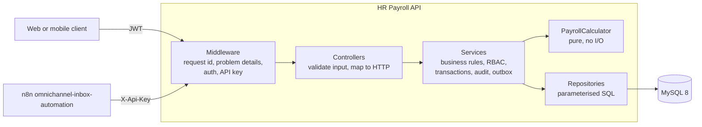
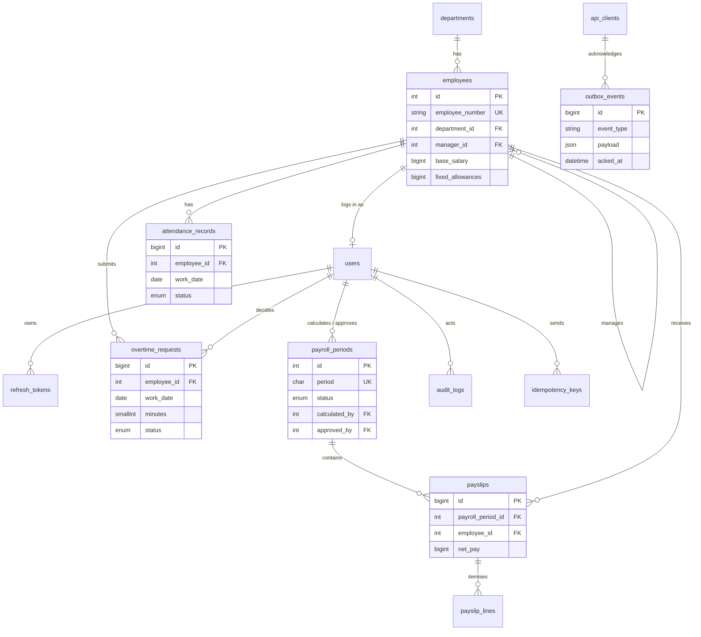

# HR Payroll API

REST API for attendance, overtime approval and monthly payroll runs under Indonesian rules
(PP 35/2021 overtime multipliers, BPJS contributions), with period locking, an audit trail
and a transactional outbox for integrations.

[](https://github.com/okaadabi-lab/hr-payroll-api/actions/workflows/ci.yml)

> Portfolio project. All data in this repository is fictional sample data.

## Overview

A small service business pays its staff monthly. Attendance is recorded daily, overtime has to
be approved by the employee's manager and must respect legal limits, and once payroll is
approved nobody should be able to change the inputs that produced it. Other systems (here the
n8n workflows in [omnichannel-inbox-automation](https://github.com/okaadabi-lab/omnichannel-inbox-automation),
which message employees) need to know when payslips are published, without the payroll API
calling them directly.

This API covers that flow:

```
attendance + approved overtime + holidays + BPJS settings
        -> calculate (draft / calculated)
        -> approve (locked, payslips published)
        -> mark paid
```

## Features

- **Auth**: JWT access tokens (15 min), opaque refresh tokens stored as hashes, rotated on every
  use, with reuse detection that revokes the whole token family. Login throttling per email + IP.
- **Roles enforced in services**: admin, hr, manager, employee. Managers see only their direct
  reports (and not their salaries), employees only themselves.
- **Attendance**: CRUD, self-service clock-in/out in the company time zone, and CSV bulk import
  with a per-row error report.
- **Overtime**: submit, approve or reject. PP 35/2021 limits (4 h/day, 18 h/week on workdays) are
  validated on submission. Nobody approves their own request; managers only their direct reports.
- **Payroll periods** (`YYYY-MM`): draft, calculated, approved, paid.
  - Calculation is idempotent through the `Idempotency-Key` header.
  - Approval requires an admin who did not run the calculation (segregation of duties).
  - Approved periods are locked: attendance, overtime and holiday writes in them return 409.
  - Changing the inputs of a calculated period sends it back to draft, so stale figures cannot be
    approved.
- **Pure calculator** with integer rupiah and one documented rounding rule
  ([docs/payroll-rules.md](docs/payroll-rules.md)).
- **Transactional outbox**: `payslip.published` and `payroll.paid` events written in the same
  transaction as the state change, read and acknowledged by API-key clients
  ([docs/integrations.md](docs/integrations.md)).
- **Audit log** with actor, IP and before/after JSON for salary changes, approvals and payroll
  state changes.
- Pagination with `meta` and `links`, filtering, whitelisted sorting and name search on lists.
- RFC 7807 problem responses, `X-Request-Id` on every response, JSON logs to stdout.

## Tech stack

PHP 8.3, Slim 4, MySQL 8 / MariaDB 10.11 (PDO), firebase/php-jwt, Monolog, phpdotenv.
PHPUnit 11, PHPStan level 8, PHP_CodeSniffer (PSR-12), GitHub Actions.

## Architecture



Controllers validate input and call one service method. Services own the business rules,
authorisation and transaction boundaries, so every path to the data is checked the same way.
Repositories hold all SQL with bound parameters. The payroll calculator is plain PHP with no
database or clock. [docs/architecture.md](docs/architecture.md) has the layer notes and the
approval sequence (lock, audit, outbox, commit).

## Database



Constraints carry part of the rules: one attendance record per employee and day, one payslip per
employee and period, `net_pay = gross_pay - total_deductions`, and approver ≠ calculator are
enforced by UNIQUE and CHECK constraints. Payslips snapshot the employee's name, number and
department. The reference tables and the full list are in
[docs/architecture.md](docs/architecture.md#database-constraints).

## API

All paths except `/health` are under `/api/v1`: auth, master data, attendance, overtime, payroll
periods, payslips, the integration outbox, health and audit logs. Errors are RFC 7807 problem
documents with a stable `code`. The contract is [docs/openapi.yaml](docs/openapi.yaml)
(OpenAPI 3.1), and a test fails if a Slim route and the spec disagree.
[docs/api.md](docs/api.md) lists the endpoints with an example session.

## Getting started

Requirements: PHP 8.3 with `pdo_mysql`, Composer, and MySQL 8 or MariaDB 10.11.

```bash
composer install
cp .env.example .env          # set DB_* and a JWT_SECRET of at least 32 characters
php bin/migrate               # add --fresh to drop and recreate (refused when APP_ENV=production)
php bin/seed                  # fictional company; prints the users and an outbox API key
composer serve                # http://localhost:8082
```

Or with Docker (MySQL 8 and the API on port 8082; the container runs migrations on start):

```bash
docker compose up -d
docker compose exec app php bin/seed
```

Seeded users all use the password `Password123!`: `admin@example.test` and
`admin2@example.test` (two admins, for segregation of duties), `hr@example.test`, managers
`dina.kartika@example.test` and `raka.pratama@example.test`, and three employees.
[docs/operations.md](docs/operations.md) lists them all, with every environment variable.

The integration tests need an empty database whose name ends in `_test` (the bootstrap refuses
anything else). It is dropped and migrated at the start of every run.

```bash
DB_USERNAME=... DB_PASSWORD=... composer test     # 158 tests: unit + integration (hr_payroll_test)
composer lint                                     # PHPCS (PSR-12) + PHPStan level 8
```

`phpunit.xml` sets `DB_DATABASE=hr_payroll_test`; credentials come from `.env` or the
environment. CI runs the same commands against a MySQL 8 service container.

## Design decisions

- **Integers for money, one rounding rule.** Every amount is integer rupiah and every line is
  rounded half up once, at the end of its own formula. The hourly overtime rate is never rounded
  on its own, which keeps results independent of how hours are split across days.
- **Calculator separated from I/O.** The service gathers inputs, the calculator is a pure
  function of them. That makes the money logic testable with plain unit tests and lets the docs
  quote numbers that come straight from a test.
- **Idempotency in the same transaction.** The key is reserved, the calculation runs and the
  response is stored in one transaction. A failed calculation rolls back the key too, so the
  client can retry with it; a concurrent duplicate waits on the unique index and then replays.
  Keys are scoped per user and the request hash includes the path, so a key reused for another
  period is rejected.
- **Locking by row lock, not by convention.** Every write to payroll inputs takes
  `SELECT ... FOR UPDATE` on the matching period row inside its transaction. Approval takes the
  same lock, so "write lands after approval" is impossible rather than unlikely.
- **Pull-based outbox.** The API never calls n8n. Delivery is at least once; consumers
  de-duplicate on the event id. This keeps payroll approval independent of any external system.
- **Rest-day overtime limits.** PP 35/2021 caps overtime at 4 h/day and 18 h/week but pays rest
  day overtime up to the 12th hour. This API applies the 4 h / 18 h caps to workdays and a
  12 h/day cap to rest days and holidays, in one place (`OvertimeLimitCheck`).

Two smaller decisions (all-or-nothing CSV import of the valid rows, manual wiring with plain SQL)
are in [docs/architecture.md](docs/architecture.md#further-design-decisions). Every payroll
formula, with a worked example, is in [docs/payroll-rules.md](docs/payroll-rules.md).

## Limitations and future work

- **PPh 21 income tax is not calculated.** Net pay here is gross pay minus absence and employee
  BPJS shares. A real payroll must add PPh 21 (TER monthly rates, December reconciliation, PTKP).
- **BPJS caps change every year.** The seed uses a JP wage cap of 10,547,400 (in force since
  March 2025) and a Kesehatan cap of 12,000,000. Update `bpjs_settings` from the official BPJS announcement before the first
  payroll each year. JKK is seeded at the lowest risk-group rate (0.24 %).
- No pro-rating for employees who join or leave mid-month, no effective-dated salary changes,
  no THR, bonuses or loans, five-day week only. Inactive employees are left out of a
  calculation entirely, so deactivate leavers after their final payroll.
- Public holidays are entered manually; the seed contains a subset of 2026 holidays.
- Payslips are JSON only, no PDF.
- Rate limiting covers login only. Other endpoints would need a limiter at the gateway.
- Access tokens cannot be revoked before they expire (15 minutes); logout revokes the refresh
  token family.
- The outbox has no retention job; acknowledged events stay in the table.

## Part of a portfolio

[omnichannel-inbox-automation](https://github.com/okaadabi-lab/omnichannel-inbox-automation)
polls this API's outbox and sends each employee a WhatsApp template message when a payslip is
published or salary is paid. That is the only runtime integration; the API does not depend on it.
