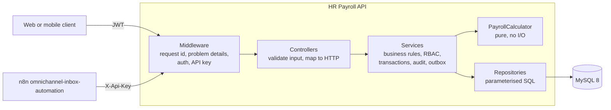
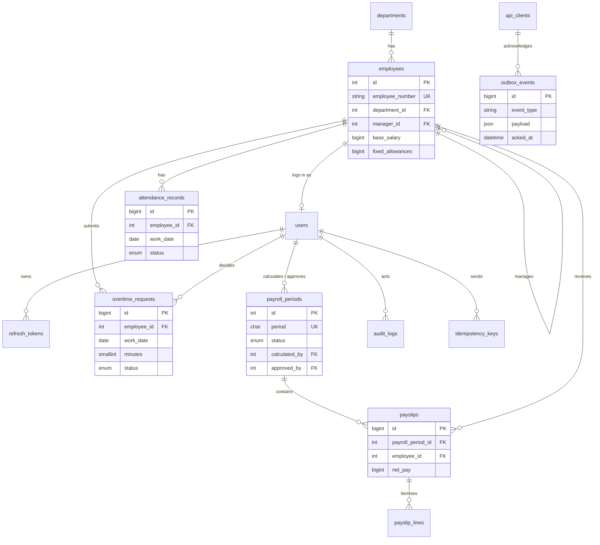

# HR Payroll API

REST API for attendance, overtime approval and monthly payroll runs under Indonesian rules
(PP 35/2021 overtime multipliers, BPJS contributions), with period locking, an audit trail
and a transactional outbox for integrations.

Portfolio project. All data in this repository is fictional sample data.

## Overview

A small service business pays its staff monthly. Attendance is recorded daily, overtime has to
be approved by the employee's manager and must respect legal limits, and once payroll is
approved nobody should be able to change the inputs that produced it. Other systems (here an
n8n workflow that messages employees) need to know when payslips are published, without the
payroll API calling them directly.

This API covers that flow:

```
attendance + approved overtime + holidays + BPJS settings
        -> calculate (draft / calculated)
        -> approve (locked, payslips published)
        -> mark paid
```

## Features

- **Auth**: JWT access tokens (15 min), opaque refresh tokens stored as hashes, rotated on every
  use, with reuse detection that revokes the whole token family. Login throttling per email + IP.
- **Roles enforced in services**: admin, hr, manager, employee. Managers see only their direct
  reports (and not their salaries), employees only themselves.
- **Attendance**: CRUD, self-service clock-in/out in the company time zone, and CSV bulk import
  with a per-row error report.
- **Overtime**: submit, approve or reject. PP 35/2021 limits (4 h/day, 18 h/week on workdays) are
  validated on submission. Nobody approves their own request; managers only their direct reports.
- **Payroll periods** (`YYYY-MM`): draft, calculated, approved, paid.
  - Calculation is idempotent through the `Idempotency-Key` header.
  - Approval requires an admin who did not run the calculation (segregation of duties).
  - Approved periods are locked: attendance, overtime and holiday writes in them return 409.
  - Changing the inputs of a calculated period sends it back to draft, so stale figures cannot be
    approved.
- **Pure calculator** with integer rupiah and one documented rounding rule
  ([docs/payroll-rules.md](docs/payroll-rules.md)).
- **Transactional outbox**: `payslip.published` and `payroll.paid` events written in the same
  transaction as the state change, read and acknowledged by API-key clients
  ([docs/integrations.md](docs/integrations.md)).
- **Audit log** with actor, IP and before/after JSON for salary changes, approvals and payroll
  state changes.
- Pagination with `meta` and `links`, filtering, whitelisted sorting and name search on lists.
- RFC 7807 problem responses, `X-Request-Id` on every response, JSON logs to stdout.

## Tech stack

PHP 8.3, Slim 4, MySQL 8 / MariaDB 10.11 (PDO), firebase/php-jwt, Monolog, phpdotenv.
PHPUnit 11, PHPStan level 8, PHP_CodeSniffer (PSR-12), GitHub Actions.

## Architecture



- **Controllers** are thin: they read and validate input (`Http\Input`), call one service method
  and shape the response.
- **Services** own the rules and transaction boundaries. Authorisation lives here, not only in
  routes, so every path to the data is checked the same way.
- **Repositories** contain all SQL. Values are always bound parameters; sort columns come from
  per-repository whitelists.
- **Domain\Payroll** is the calculator: plain PHP objects, no database, no clock. It is the most
  heavily tested part.
- **Container** wires everything by hand in one file. There is no autowiring to reason about.

Payroll approval, step by step:

```mermaid
sequenceDiagram
    participant A as Admin
    participant API as PayrollService
    participant DB as MySQL
    participant N as n8n
    A->>API: POST /payroll-periods/{id}/approve
    API->>DB: BEGIN; SELECT period FOR UPDATE
    API->>API: status = calculated? approver != calculator?
    API->>DB: UPDATE period SET status = approved
    API->>DB: INSERT audit_logs
    API->>DB: INSERT outbox_events (one per payslip)
    API->>DB: COMMIT
    N->>API: GET /integrations/outbox
    N->>N: send WhatsApp / email
    N->>API: POST /integrations/outbox/ack
```

## Database



Reference tables not shown: `holidays`, `bpjs_settings` (append-only, with `effective_from`),
`login_attempts`, `api_clients`. Constraints worth noting: unique `(employee_id, work_date)` on
attendance, unique `(payroll_period_id, employee_id)` on payslips, a CHECK that
`net_pay = gross_pay - total_deductions`, a CHECK that the approver differs from the calculator,
and a CHECK limiting overtime to 12 hours per request.

Payslips store a snapshot of the employee's name, number and department so an approved payslip
does not change when master data changes later.

## API

The full contract is in [docs/openapi.yaml](docs/openapi.yaml) (OpenAPI 3.1). A test fails if a
route is registered in Slim but missing from the spec, or the other way round.

| Area | Endpoints |
| --- | --- |
| Auth | `POST /auth/login`, `POST /auth/refresh`, `POST /auth/logout`, `GET /me` |
| Master data | `/departments`, `/employees`, `POST /users`, `/holidays`, `/bpjs-settings` |
| Attendance | `/attendance`, `POST /attendance/import`, `POST /attendance/clock-in`, `POST /attendance/clock-out` |
| Overtime | `/overtime-requests`, `POST /overtime-requests/{id}/approve`, `.../reject` |
| Payroll | `/payroll-periods`, `POST .../{id}/calculate`, `.../approve`, `.../mark-paid`, `GET .../{id}/payslips` |
| Payslips | `GET /payslips`, `GET /payslips/{id}` |
| Integrations | `GET /integrations/outbox`, `POST /integrations/outbox/ack` (API key) |
| Ops | `GET /health`, `GET /audit-logs` |

All paths except `/health` are under `/api/v1`.

Example session:

```bash
TOKEN=$(curl -s -X POST localhost:8082/api/v1/auth/login \
  -H 'Content-Type: application/json' \
  -d '{"email":"hr@example.test","password":"Password123!"}' | jq -r .access_token)

curl -s -X POST localhost:8082/api/v1/payroll-periods -H "Authorization: Bearer $TOKEN" \
  -H 'Content-Type: application/json' -d '{"period":"2026-08"}'

curl -s -X POST localhost:8082/api/v1/payroll-periods/1/calculate \
  -H "Authorization: Bearer $TOKEN" -H 'Idempotency-Key: calc-2026-08-001'
```

An error looks like this:

```json
{
  "type": "urn:hr-payroll:problem:validation_failed",
  "title": "Unprocessable Content",
  "status": 422,
  "detail": "Overtime exceeds the limits of PP 35/2021.",
  "instance": "/api/v1/overtime-requests",
  "code": "validation_failed",
  "request_id": "6f1c0d0e9a3b4f52b8f1e0c7d2a4b6e8",
  "errors": [
    { "field": "hours", "message": "Overtime on a workday is limited to 4 hours per day; 0 hours already requested." }
  ]
}
```

## Getting started

Requirements: PHP 8.3 with `pdo_mysql`, Composer, and MySQL 8 or MariaDB 10.11.

```bash
composer install
cp .env.example .env          # set DB_* and a JWT_SECRET of at least 32 characters
php bin/migrate               # add --fresh to drop and recreate (refused when APP_ENV=production)
php bin/seed                  # fictional company; prints the users and an outbox API key
composer serve                # http://localhost:8082
```

Or with Docker (MySQL 8 and the API on port 8082):

```bash
docker compose up -d
docker compose exec app php bin/seed
```

Seeded users all use the password `Password123!`:

| Email | Role | Notes |
| --- | --- | --- |
| `admin@example.test`, `admin2@example.test` | admin | two admins to show segregation of duties |
| `hr@example.test` | hr | |
| `dina.kartika@example.test` | manager | manages Budi and Sari |
| `raka.pratama@example.test` | manager | manages Nina |
| `budi.santoso@example.test`, `sari.wulandari@example.test`, `nina.lestari@example.test` | employee | |

### Environment variables

| Variable | Purpose |
| --- | --- |
| `APP_ENV`, `APP_DEBUG` | `bin/seed` and `bin/migrate --fresh` refuse to run when `APP_ENV=production`. `APP_DEBUG=true` adds exception class and message to 500 responses (never the trace) |
| `APP_URL` | Base URL used in `payslip_url` of outbox events |
| `APP_TIMEZONE` | Company time zone for clock-in/out (default `Asia/Jakarta`); storage is UTC |
| `DB_HOST`, `DB_PORT`, `DB_DATABASE`, `DB_USERNAME`, `DB_PASSWORD` | Database connection |
| `JWT_SECRET`, `JWT_ISSUER` | HS256 signing key (32+ characters) and issuer claim |
| `ACCESS_TOKEN_TTL`, `REFRESH_TOKEN_TTL` | Seconds; defaults 900 and 2592000 |
| `LOGIN_MAX_ATTEMPTS`, `LOGIN_WINDOW_SECONDS` | Failed logins allowed per email + IP per window |
| `LOG_LEVEL` | Monolog level for the JSON logs on stdout |

### Tests and checks

The integration tests need an empty database whose name ends in `_test` (the bootstrap refuses
anything else). It is dropped and migrated at the start of every run.

```bash
DB_USERNAME=... DB_PASSWORD=... composer test     # 153 tests: unit + integration (hr_payroll_test)
composer lint                                     # PHPCS (PSR-12) + PHPStan level 8
```

`phpunit.xml` sets `DB_DATABASE=hr_payroll_test`; credentials come from `.env` or the
environment. CI runs the same commands against a MySQL 8 service container.

## Design decisions

- **Integers for money, one rounding rule.** Every amount is integer rupiah and every line is
  rounded half up once, at the end of its own formula. The hourly overtime rate is never rounded
  on its own, which keeps results independent of how hours are split across days.
- **Calculator separated from I/O.** The service gathers inputs, the calculator is a pure
  function of them. That makes the money logic testable with plain unit tests and lets the docs
  quote numbers that come straight from a test.
- **Idempotency in the same transaction.** The key is reserved, the calculation runs and the
  response is stored in one transaction. A failed calculation rolls back the key too, so the
  client can retry with it; a concurrent duplicate waits on the unique index and then replays.
  Keys are scoped per user and the request hash includes the path, so a key reused for another
  period is rejected.
- **Locking by row lock, not by convention.** Every write to payroll inputs takes
  `SELECT ... FOR UPDATE` on the matching period row inside its transaction. Approval takes the
  same lock, so "write lands after approval" is impossible rather than unlikely.
- **CSV import: validate all, insert valid rows in one transaction.** Users get every row error
  in one response and can fix and re-upload only the failed rows. Because the valid rows are
  inserted atomically, an unexpected failure leaves nothing half-imported; the whole file can be
  sent again. Duplicate rows within the file and rows that already exist are reported, not
  overwritten.
- **Pull-based outbox.** The API never calls n8n. Delivery is at least once; consumers
  de-duplicate on the event id. This keeps payroll approval independent of any external system.
- **Rest-day overtime limits.** PP 35/2021 caps overtime at 4 h/day and 18 h/week but pays rest
  day overtime up to the 12th hour. This API applies the 4 h / 18 h caps to workdays and a
  12 h/day cap to rest days and holidays, in one place (`OvertimeLimitCheck`).
- **Manual wiring and plain SQL.** A small hand-written container and SQL files instead of a DI
  framework and an ORM. More typing, but nothing is hidden.

## Limitations and future work

- **PPh 21 income tax is not calculated.** Net pay here is gross pay minus absence and employee
  BPJS shares. A real payroll must add PPh 21 (TER monthly rates, December reconciliation, PTKP).
- **BPJS caps change every year.** The seed uses a JP wage cap of 10,547,400 (in force since
  March 2025) and a Kesehatan cap of 12,000,000. Update `bpjs_settings` from the official BPJS announcement before the first
  payroll each year. JKK is seeded at the lowest risk-group rate (0.24 %).
- No pro-rating for employees who join or leave mid-month, no THR, bonuses or loans, five-day
  week only.
- Public holidays are entered manually; the seed contains a subset of 2026 holidays.
- Payslips are JSON only, no PDF.
- Rate limiting covers login only. Other endpoints would need a limiter at the gateway.
- Access tokens cannot be revoked before they expire (15 minutes); logout revokes the refresh
  token family.
- The outbox has no retention job; acknowledged events stay in the table.
